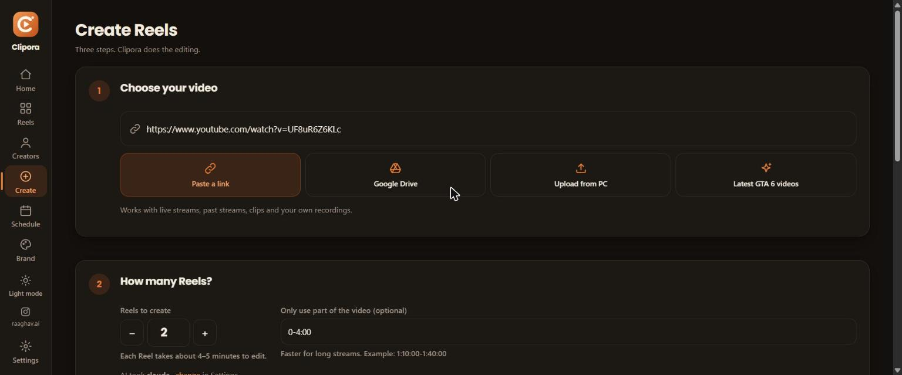
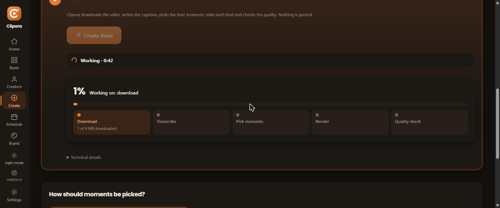
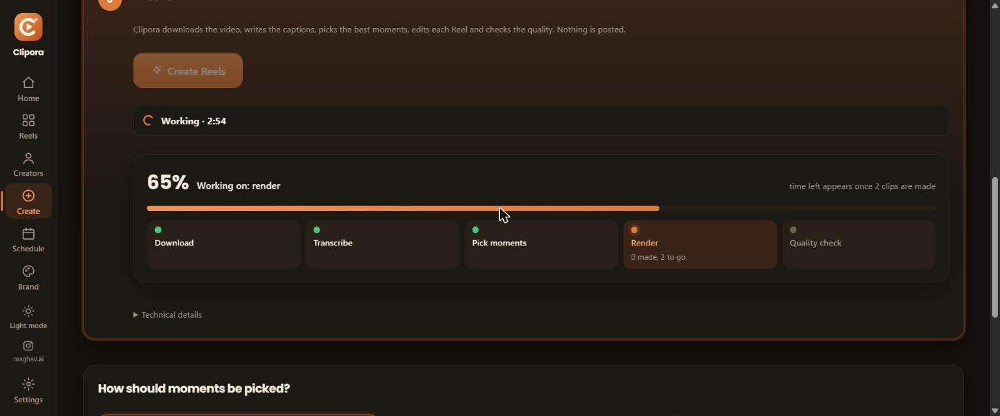
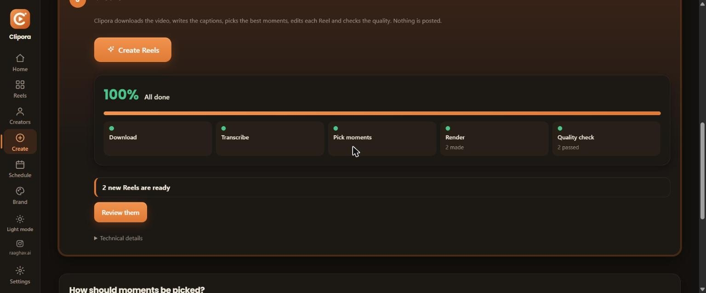

# Clipora

**Turn clips into opportunities.**

Turn any long video or live stream into short vertical reels on your own computer: captions, face framing and a hook title included. It's free, nothing gets uploaded, and nothing gets posted unless you post it yourself.

## Start in 3 steps (Windows)

1. Click the green **Code** button on this page, then **Download ZIP**. Unzip it anywhere, for example on your Desktop.
2. Open the folder and double-click **Start.bat**.
3. Wait for it to finish. The first time it installs everything it needs, which takes 5 to 15 minutes. After that your browser opens Clipora.

Keep the black window open while you use Clipora. Close it to stop the app. Next time, just double-click **Start.bat** again. It starts in a few seconds.

**Mac or Linux:** open a terminal in the folder and run `bash start.sh`.

### Install with Claude Code (or another AI coding tool)

Open Claude Code, Claude, Codex or any AI coding tool that can run commands on your computer, and paste this one prompt:

```
Install Clipora from https://github.com/raghavthakur18/Clipora with all its dependencies and start it.
Steps: download the repository into a new folder; make sure Python 3.9 to 3.12 and ffmpeg are installed (install them if missing);
then run Start.bat on Windows or "bash start.sh" on Mac and Linux, and keep it running.
When Clipora opens in the browser, tell me it is ready. If something fails, show me the error and fix it.
```

The tool installs everything and starts the app. To start it again later, paste: `Start Clipora from the folder you installed it in.`

**Use a paid model if you can.** A paid plan (for example Claude Pro or higher) gives a larger context window, so the AI can read a whole long transcript and pick better moments. Free models have a smaller context window: on long videos they can miss parts of the transcript or stop early. If you only have a free model, use **Only this part** to clip short sections, or switch to **No AI** mode in **Settings**.

## What it looks like

**1. Paste a link, choose how many reels, and press Create Reels.** For a first try, use a short video or **Only this part** (here `0-4:00`).



**2. The bar starts at once and shows the real work:** here the download, with the megabytes received.



**3. Each step fills in as it finishes.** Here the reels are rendering.



**4. 100% appears only when the reels are really finished and saved.** Press **Review them** to watch them.



## How to use it

1. **Create:** paste a link (YouTube, Twitch, Kick, TikTok, X, Instagram, Google Drive and more), upload a video from your PC, or take the latest GTA 6 videos. Choose how many reels you want, then press **Create Reels**. The progress bar starts the moment you press the button and shows each step (Download, Transcribe, Pick moments, Render, Quality check) with the real percentage of work done. It reaches 100% only when the reels are finished and saved. Each reel appears in **Today** and **Reels** as soon as it is done, while the next one is still rendering.
2. **Reels:** watch each reel, then approve it or reject it. In **Look**, a live preview shows your caption style, size, position, watermark and shape (9:16, 4:5, 1:1) as you change them. You can also pick the caption language, or ask the AI to change something in plain words.
3. **Schedule:** drag approved reels onto a calendar, or let Clipora spread them out. You then post them yourself.

Other screens:
- **Creators:** the creators you follow, who is live right now, and how many people are watching. Turn on **Live hunt** and Clipora clips them while they are live.
- **Brand:** your caption colours, font, watermark and end card.
- **Settings:** language (English, Hindi and more), English captions for any spoken language, dark mode, and the AI tool.

**Captions by default:** English speech gets English captions. Other languages keep their own language. Hindi is written in English letters (for example "mein", "hum", "toh"), never in Devanagari script. Turn on **English captions** in Settings to translate everything to English. Captions come from speech recognition, so **some words can still be misheard, especially in Hindi: read the captions before you post a reel.** See **Caption accuracy** below.

## What you need

- Windows 10/11, macOS or Linux, and about 5 GB of free space.
- An internet connection for the first setup and for downloading videos.
- Optional: a graphics card. An NVIDIA card makes the transcribe step much faster. NVIDIA, Intel and AMD cards are also used to speed up the final render when ffmpeg can use them; otherwise Clipora renders on the CPU.
- An AI tool picks the best moments. **Antigravity CLI** is the default (it works with a Google account and has an allowance set by Google). **OpenCode** has free models that need no account, and **No AI** mode works with nothing installed. Claude Code, Codex, Kimi, Ollama and Gemini CLI (only on a company plan or a paid key) also work. Change it in **Settings > AI tool**. If a tool is missing, Settings shows how to install it (see **AI tools** below).

## AI tools: setup and automatic switching

- **Default:** Antigravity CLI. If it is not installed yet, Clipora still works: it picks moments without AI and Settings shows the steps to set Antigravity up.
- **Install for me (Windows):** in **Settings > AI tool**, a tool that is not found shows an **Install for me** button for Antigravity, OpenCode and Claude Code. It first shows the exact commands, then runs them only after you press **Yes, install**, and shows the progress. Windows may ask for administrator permission. **Clipora never signs in for you:** if a tool needs a sign-in (Antigravity does: type `agy` once and sign in with Google in your browser), you do that yourself. On Mac and Linux, and for other tools, Settings shows the steps to follow by hand.
- **Automatic switching:** when you press Create Reels, the picking step tries your chosen tool first. If it runs out of quota, crashes, hangs, is not installed, or gives unusable picks, Clipora moves on to the next one: **Antigravity, then OpenCode, then No AI** (which always works). A tool that ran out of quota is skipped for an hour so later runs do not wait for it. Turn it off with **Auto-switch** in Settings. Choosing **No AI** is always respected: no AI tool is ever called.
- **Free usage:** Antigravity's free allowance and its limits are set by Google, are not published as numbers, and can differ from account to account or change. OpenCode's free models are free for a limited time, some of them keep your data, and their picks are usually weaker. **No AI** is free with no limit but picks only from loudness, chat and keywords.

## Caption accuracy

**Settings > Caption accuracy** has three choices:

- **Fast:** the small speech model. Works on any computer. Hindi is often misheard.
- **Accurate:** the large model (`large-v3-turbo`, about 1.6 GB, downloaded the first time you use it). Needs an NVIDIA graphics card with about 6 GB or more.
- **Auto (default):** uses the large model only when the graphics card is big enough **and** the model is already downloaded. It never starts a large download by itself. Choose **Accurate** once to download it. If the large model cannot start, Clipora falls back to the small one.

English-captions mode always uses the small model. Hindi spelling in English letters uses a table of common everyday words ("mein", "hum", "toh", "police", "game"...).

## What was tested (and what was not)

Checked on one Windows 11 laptop with a 6 GB NVIDIA graphics card, with one 16-minute Hindi gaming video:

- **Automatic tests** (`python test_switch.py`, `python test_captions.py`, `python test_install.py`): the switching between tools (quota errors, hung or broken tools, missing tools, No AI), the caption model choice and its fallback, the Hindi spelling table, and the install button's safety rules (fake tools, nothing is installed). All pass.
- **Real tools:** Antigravity picked moments; OpenCode took over when Antigravity was paused or returned a quota error; with both failing, No AI picks worked.
- **Full runs from Create Reels** (2 reels): about 20 minutes in total with Antigravity: transcribing about 4 minutes with the large model (about 10 minutes with the small one), picking 3 to 11 minutes (varies), rendering about 5 minutes. With OpenCode the picking took about 1 minute.
- **Install for me:** the real Windows installer path ran and its progress and error messages showed in Settings. A fresh install of a missing tool through the button was **not** tested.
- **Caption quality:** much better than with the small model, but **not accurate yet**: in the test video some Hindi words were still misheard, and spelling was better than before.
- **Not tested:** Mac, Linux, graphics cards smaller than 6 GB, computers without a graphics card, and other users' free Antigravity limits.

## Good to know

- **Shorter videos finish much faster.** The time depends on how long the video is, because Clipora downloads it, transcribes every minute of speech, then renders each reel. A 4-minute video gave 2 finished reels in under 5 minutes on a normal laptop. A 2-hour video can take 30 to 60 minutes the first time, mostly for transcribing. If you can, give Clipora a short video (about 5 minutes or less), or use **Only this part** (for example `1:10:00-1:40:00`) to cut reels from just one section of a long video.
- You can reload the page or close the tab while a run is working. The run keeps going, and when you come back the progress bar and the timer show where it really is.
- If a reel shows a black picture, the app was probably closed. Reels are played from the running app, so keep the black window (or terminal) open and reload the page.
- Your reels, settings and keys stay on your computer, in the `workspace` folder. That folder is never uploaded to GitHub.
- Only clip videos you have the rights to use, and credit the creator.

---

This system is created by Raghav. Instagram: [raaghav.ai](https://www.instagram.com/raaghav.ai/)

Free and open source under the [MIT License](LICENSE).
